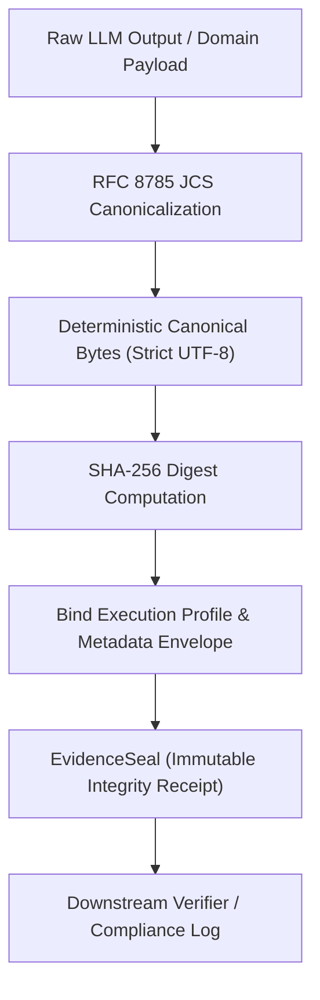

# open-evidence

[](https://github.com/huangbuqubunao-alt/open-evidence/actions)
[](https://opensource.org/licenses/MIT)
[](https://www.python.org/downloads/)

**Deterministic Content Integrity and Provenance Engine for AI Pipelines (RFC 8785 JCS + SHA-256 Digest Envelopes)**

`open-evidence` solves a foundational infrastructure challenge in modern production AI systems: **how to ensure deterministic serialization and verifiable content integrity for AI model outputs, execution configs, and structured artifacts.**

By combining a pure standard-library implementation of **RFC 8785 JSON Canonicalization Scheme (JCS)** with SHA-256 seal envelopes and provider-neutral execution contracts, `open-evidence` enables developers to establish an auditable, bit-exact record for LLM-driven applications.

[中文文档 (README.zh-CN.md)](README.zh-CN.md)

---

## Security Boundaries & Cryptographic Claims

To maintain complete cryptographic rigor, `open-evidence` clearly distinguishes between integrity, authenticity, and semantic factuality:

| Property | What `open-evidence` Guarantees | What It Does NOT Guarantee (Requires External Infrastructure) |
|:---|:---|:---|
| **Content Integrity** | **GUARANTEED**: Uses RFC 8785 JCS canonical bytes and SHA-256 to detect any in-transit byte modification, bit rot, or payload mutation against an authentic seal.<br>*(Note: Guarantees canonical JSON structural integrity. To seal raw binary streams, hash raw bytes directly. Python dictionaries/lists remain mutable in-memory; modify-after-seal will trigger a verification failure).* | Does not prevent an active attacker from replacing *both* the payload and unkeyed seal if transmitted over an untrusted channel. |
| **Origin Authenticity** | **Execution Context Binding**: Deterministically binds model prompt, execution profile (hyperparameters), raw response, and metadata into a canonical digest envelope. | **Not Autonomous Author Authentication**: Unkeyed SHA-256 proves data matching, not author identity. For non-repudiation, sign the `EvidenceSeal.seal_sha256` with a private key (e.g., Ed25519) or anchor it in a trusted log. |
| **Factual Truth** | **Byte Preservation**: Verifies that the recorded text and structured fields are preserved exactly as captured at runtime. | **Not Semantic Truth**: Cryptographic hashing cannot evaluate whether the LLM's claims are factual, accurate, or free from hallucinations. |
| **Timestamping** | **System Recorded Time**: Records an ISO-8601 UTC timestamp in the canonical envelope preimage. | **Not a TSA Token**: It is a self-asserted ISO-8601 UTC timestamp string captured at runtime, not an RFC 3161 cryptographically certified timestamp from a Timestamp Authority. |

---

## Key Features

- **Standard RFC 8785 Canonicalization (JCS)**:
  - 100% dependency-free, pure Python implementation conforming to RFC 8785 and ECMA-262 Section 7.1.12.1.
  - Strict UTF-16 code-unit property sorting and exact ECMAScript `NumberToString` formatting.
  - Enforces I-JSON (RFC 7493) safe integer boundaries `[-(2^53 - 1), 2^53 - 1]`.
  - Duplicate key detection and rejection (fail-closed against hash collisions).
  - Passes official RFC 8785 test vectors with byte-for-byte differential parity against ECMAScript/Node.js engines.
- **Content Integrity Sealing**:
  - Deterministic SHA-256 evidence digests binding payloads, model profiles, timestamps, and caller metadata.
  - Automated modification detection for downstream consumers, CI pipelines, and compliance audit trails.
- **Provider-Neutral Model Contracts**:
  - Immutable domain contracts for structured LLM returns across OpenAI, Anthropic, and local runtimes.
  - Ordered fallback chains with duplicate and cycle prevention.
- **Minimal Dependencies**:
  - Standalone JCS core (`open_evidence.jcs`) has zero external dependencies (100% Python standard library).
  - Runtime models require only `pydantic>=2.0` for structured contract validation.

---

## Installation

```bash
pip install open-evidence
```

Or using `uv`:

```bash
uv add open-evidence
```

---

## Quickstart

### 1. Seal an Arbitrary Evidence Payload

```python
from open_evidence import seal_payload, verify_seal

payload = {
    "claim": "Quarterly operating profit increased by 14.2%",
    "source_documents": ["sec_10k_item7.pdf#p42"],
    "confidence_score": 0.96
}

# Generate deterministic cryptographic integrity seal
seal = seal_payload(payload, metadata={"auditor": "compliance-agent-01"})
print(f"Payload Hash: {seal.payload_sha256}")
print(f"Seal Hash:    {seal.seal_sha256}")

# Verify content integrity
result = verify_seal(payload, seal, strict=True)
assert result.is_valid is True
```

### 2. Detect In-Transit Payload Modification

```python
from open_evidence import verify_seal, IntegrityVerificationError

# Downstream consumer receives an altered payload
tampered_payload = {
    "claim": "Quarterly operating profit increased by 14.2%",
    "source_documents": ["sec_10k_item7.pdf#p42"],
    "confidence_score": 0.99  # Modified!
}

result = verify_seal(tampered_payload, seal)
print(f"Is Valid: {result.is_valid}")
# Output: Is Valid: False
# Error: Payload hash mismatch: computed digest is ..., seal asserts ...
```

### 3. Audit an LLM Structured Generation

```python
from open_evidence import (
    AuditedModelResponse,
    ExecutionProfile,
    ModelProviderKind,
    StructuredOutputMode,
)

profile = ExecutionProfile(
    provider_kind=ModelProviderKind.CLOUD_OPENAI,
    provider_id="openai-main",
    model_name="o3-mini",
    output_mode=StructuredOutputMode.PROVIDER_JSON_SCHEMA,
    temperature=0.0,
)

response = AuditedModelResponse.create(
    prompt="Extract key terms from loan contract.",
    profile=profile,
    raw_response='{"interest_rate": 0.045, "maturity_years": 10}',
    structured_data={"interest_rate": 0.045, "maturity_years": 10},
)

print(f"Audited Profile Hash: {response.profile_sha256}")
print(f"Seal Timestamp:       {response.seal.created_at}")

# Downstream verification: validates profile consistency, seal, and prompt binding
verification = response.verify(prompt="Extract key terms from loan contract.")
assert verification.is_valid is True
```

---

## Architecture



See [docs/architecture.md](docs/architecture.md) for full technical specifications.

---

## Quality & Testing

- **Comprehensive test suite** covering RFC 8785 normative test vectors, safe integer boundaries, profile tampering detection, and differential parity against Node.js ECMAScript engine.
- Strict `mypy` typing across all public APIs.
- Continuous Integration running across Python 3.10, 3.11, 3.12, and 3.13.

Run tests locally:

```bash
pytest -v
```

---

## Contributing & Security

- Contributions are welcome! See [CONTRIBUTING.md](CONTRIBUTING.md).
- To report a security vulnerability, please follow our [SECURITY.md](SECURITY.md) disclosure policy.

---

## License

This project is licensed under the [MIT License](LICENSE).
