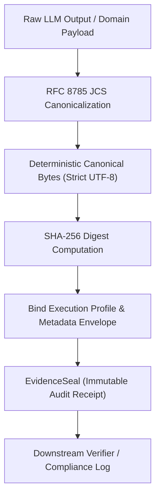

# open-evidence

[](https://github.com/huangbuqubunao-alt/open-evidence/actions)
[](https://opensource.org/licenses/MIT)
[](https://www.python.org/downloads/)

**Verifiable AI Evidence & Provenance Engine for deterministic, tamper-evident LLM pipelines.**

`open-evidence` solves a foundational challenge in modern production AI systems: **how to cryptographically prove that an AI model output is authentic, reproducible, and has not been altered or hallucinated in transit.**

By combining a pure standard-library implementation of **RFC 8785 JSON Canonicalization Scheme (JCS)** with SHA-256 seal envelopes and provider-neutral execution contracts, `open-evidence` enables developers to establish an auditable chain of custody for any LLM-driven application.

[中文文档 (README.zh-CN.md)](README.zh-CN.md)

---

## Key Features

- **Standard RFC 8785 Canonicalization (JCS)**:
  - 100% dependency-free, pure Python implementation conforming to ECMA-262 Section 7.1.12.1.
  - Strict UTF-16 code-unit property sorting and exact ECMAScript `NumberToString` formatting.
  - Duplicate key detection and rejection (fail-closed against hash collisions).
- **Cryptographic Evidence Sealing**:
  - Deterministic SHA-256 evidence digests binding payloads, model profiles, timestamps, and caller metadata.
  - Automated tamper detection for downstream consumers and compliance audits.
- **Provider-Neutral Model Contracts**:
  - Immutable domain contracts for structured LLM returns across OpenAI, Anthropic, and local runtimes.
  - Directed Acyclic Graph (DAG) fallback policies with cycle and runaway recursion guards.
- **Zero Heavy Dependencies**:
  - Requires only `pydantic>=2.0` for runtime models; JCS core is 100% Python standard library.

---

## Installation

```bash
pip install open-evidence
```

Or using `uv`:

```bash
uv add open-evidence
```

---

## Quickstart

### 1. Seal an Arbitrary Evidence Payload

```python
from open_evidence import seal_payload, verify_seal

payload = {
    "claim": "Quarterly operating profit increased by 14.2%",
    "source_documents": ["sec_10k_item7.pdf#p42"],
    "confidence_score": 0.96
}

# Generate cryptographic seal
seal = seal_payload(payload, metadata={"auditor": "compliance-agent-01"})
print(f"Payload Hash: {seal.payload_sha256}")
print(f"Seal Hash:    {seal.seal_sha256}")

# Verify integrity
result = verify_seal(payload, seal, strict=True)
assert result.is_valid is True
```

### 2. Detect In-Transit Tampering

```python
from open_evidence import verify_seal, TamperedEvidenceError

# An unauthorized party alters the confidence score
tampered_payload = {
    "claim": "Quarterly operating profit increased by 14.2%",
    "source_documents": ["sec_10k_item7.pdf#p42"],
    "confidence_score": 0.99  # Altered!
}

result = verify_seal(tampered_payload, seal)
print(f"Is Valid: {result.is_valid}")
# Output: Is Valid: False
# Error: Payload hash mismatch: payload hash is ..., seal asserts ...
```

### 3. Audit an LLM Structured Generation

```python
from open_evidence import (
    AuditedModelResponse,
    ExecutionProfile,
    ModelProviderKind,
    StructuredOutputMode,
)

profile = ExecutionProfile(
    provider_kind=ModelProviderKind.CLOUD_OPENAI,
    provider_id="openai-main",
    model_name="o3-mini",
    output_mode=StructuredOutputMode.PROVIDER_JSON_SCHEMA,
    temperature=0.0,
)

response = AuditedModelResponse.create(
    prompt="Extract key terms from loan contract.",
    profile=profile,
    raw_response='{"interest_rate": 0.045, "maturity_years": 10}',
    structured_data={"interest_rate": 0.045, "maturity_years": 10},
)

print(f"Audited Profile Hash: {response.profile_sha256}")
print(f"Seal Timestamp:       {response.seal.created_at}")
```

---

## Architecture



See [docs/architecture.md](docs/architecture.md) for full technical specifications.

---

## Quality & Testing

- **100% test coverage** for RFC 8785 normative test vectors.
- Strict `mypy` typing across all public APIs.
- Continuous Integration running across Python 3.10, 3.11, 3.12, and 3.13.

Run tests locally:

```bash
pytest
```

---

## Contributing & Security

- Contributions are welcome! See [CONTRIBUTING.md](CONTRIBUTING.md).
- To report a security vulnerability, please follow our [SECURITY.md](SECURITY.md) disclosure policy.

---

## License

This project is licensed under the [MIT License](LICENSE).
